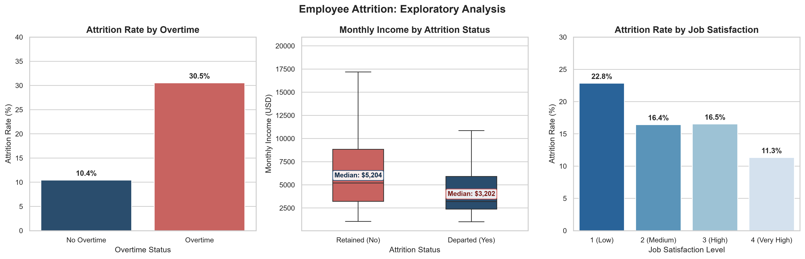
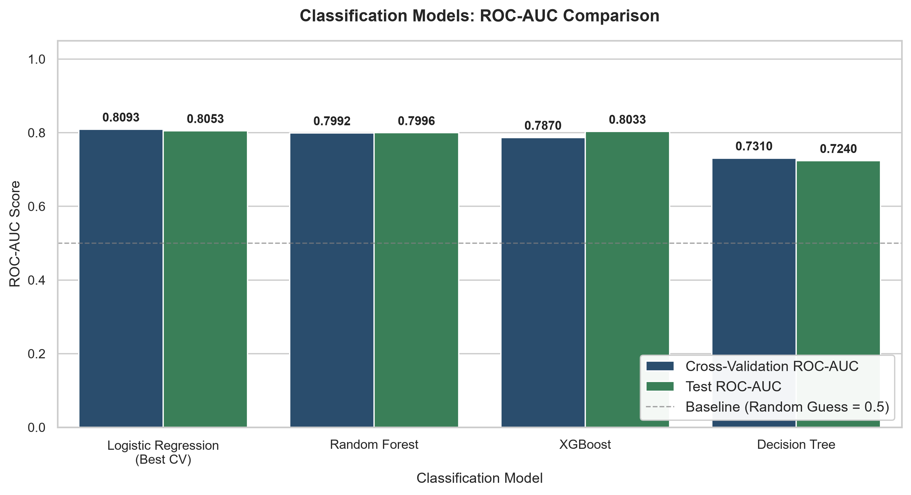

# HR Analytics: Employee Attrition Prediction

**Machine Learning Zoomcamp — Midterm Project**  
**Author:** Aldair Maquera  

---

## 1. Problem Description

Employee turnover (**Employee Attrition**) is one of the most critical operational and financial challenges organizations face. Human resources research (e.g., SHRM) estimates that replacing a qualified employee typically costs between **50% and 200% of their annual salary**, accounting for recruitment fees, onboarding time, loss of institutional knowledge, and team disruption.

### Project Objective
The goal of this project is to build an end-to-end Machine Learning pipeline that estimates the probability of voluntary employee attrition. This project was developed as the Midterm Project for the **Machine Learning Zoomcamp** (DataTalks.Club).

By providing probabilistic risk estimates, People Operations and HR teams can:
- Identify team members showing higher statistical patterns associated with turnover.
- Explore personalized retention actions (workload rebalancing, compensation reviews, career progression, mentorship).
- Support strategic workforce planning and minimize unnecessary turnover expenses.

> **Note on Causality:** The relationships identified in this project represent statistical associations observed in the dataset. They provide actionable signals for decision support, but should not be interpreted as proven causal mechanisms.

### Dataset
This project uses the **IBM HR Analytics Employee Attrition** dataset (stored in `data/employee_attrition.csv`), containing **1,470 records and 35 variables** spanning demographic details, compensation, job evaluations, role characteristics, and workplace satisfaction indicators.

---

## 2. Exploratory Data Analysis (EDA)

The complete exploratory analysis is documented in [`notebook.ipynb`](notebook.ipynb). Key findings include:

1. **Target Class Imbalance:** Approximately **16.1%** of employees left the company (`target = 1`), while **83.9%** remained (`target = 0`). Because of this class imbalance, **ROC-AUC** is used as the primary evaluation metric rather than accuracy.
2. **Overtime Work (`overtime`):** Employees working overtime exhibit an attrition rate of **30.5%**, compared to **10.4%** for employees without overtime.
3. **Monthly Compensation (`monthlyincome`):** The income distribution is right-skewed across both groups. Departing employees show a substantially lower median monthly income (**$3,202 USD**) compared to retained employees (**$5,204 USD**).
4. **Job Satisfaction (`jobsatisfaction`):** Attrition rate decreases progressively from **22.8%** among employees with low satisfaction (rating 1) down to **11.3%** for very high satisfaction (rating 4).



---

## 3. Model Comparison and Tuning

Four supervised classification families were trained and evaluated on stratified splits (80% train, 20% test). Models were evaluated primarily using **ROC-AUC** to reliably measure ranking capability despite class imbalance.

| Classification Model | Validation ROC-AUC (Baseline) | 5-Fold CV ROC-AUC | Test ROC-AUC (Final) |
|---|:---:|:---:|:---:|
| **Logistic Regression** *(Selected)* | 0.8308 | **0.8093 +/- 0.031** | **0.8053** |
| **Random Forest Classifier** | **0.8393** | 0.7992 +/- 0.022 | 0.7996 |
| **XGBoost Classifier** | 0.7808 | 0.7870 +/- 0.025 | 0.8033 |
| **Decision Tree Classifier** | 0.7584 | 0.7310 +/- 0.035 | 0.7240 |



### Final Model Selection
**Logistic Regression** (with regularizer `C=1.0`, `solver='liblinear'`) was selected as the final model due to:
- **Strong Generalization:** Highest average score and stability across 5-Fold Cross-Validation (**0.8093**) and the unseen Test set (**ROC-AUC: 0.8053**, **Test Accuracy: 88.8%**).
- **Interpretability:** Clean feature coefficients that clearly indicate the directional influence of each factor.
- **Efficiency:** Minimal compute footprint, near-zero inference latency, and lightweight deployment requirements.

---

## 4. Repository Structure

```text
mlzoomcamp-midterm-project/
├── data/
│   └── employee_attrition.csv       # Original dataset
├── img/
│   ├── eda_attrition_insights.png   # Exploratory data analysis charts
│   └── model_performance_comparison.png # Model ROC-AUC comparison chart
├── notebook.ipynb                    # EDA, model benchmarking, and hyperparameter tuning
├── train.py                         # Standalone script to train and serialize model.bin
├── predict.py                       # Local REST API service built with FastAPI
├── test_predict.py                  # Client test script for API inference
├── generate_plots.py                # Standalone script to reproduce documentation plots
├── model.bin                        # Serialized artifact (DictVectorizer + LogisticRegression)
├── pyproject.toml                   # Project dependencies managed via uv
├── uv.lock                          # Deterministic lockfile for reproducible environments
├── Dockerfile                       # Container definition for local reproducible execution
├── .gitignore                       # Git exclusion rules
└── README.md                        # Project documentation
```

---

## 5. How to Reproduce Locally

### Prerequisites
- Python 3.11 or 3.12 installed.
- Package manager `uv` installed ([uv installation guide](https://docs.astral.sh/uv/getting-started/installation/)):
  ```bash
  pip install uv
  ```

### 1. Clone the Repository and Synchronize Dependencies
```bash
git clone https://github.com/ajmaquera/mlzoomcamp-midterm-project.git
cd mlzoomcamp-midterm-project
uv sync
```

### 2. Run the Jupyter Notebook
To explore the analysis and training steps interactively:
```bash
uv run --with jupyter jupyter notebook
```
Open `notebook.ipynb` to view the EDA, modeling steps, and evaluation outputs.

### 3. Retrain and Export the Model
To re-run the training script and regenerate `model.bin`:
```bash
uv run python train.py
```

### 4. Regenerate Documentation Visualizations
To regenerate the figures in the `img/` folder:
```bash
uv run python generate_plots.py
```

---

## 6. Running the Local API Service (FastAPI)

This project provides a local REST API service for model inference.

### 1. Start the API Server Locally
```bash
uv run uvicorn predict:app --host 0.0.0.0 --port 9696
```

Once running, interactive documentation is available at:
- **Swagger UI:** `http://localhost:9696/docs`
- **Health check:** `http://localhost:9696/health`

### 2. Send a Test Request
In a separate terminal, run the client test script:
```bash
uv run python test_predict.py
```

Or using `curl`:
```bash
curl -X POST http://localhost:9696/predict \
  -H "Content-Type: application/json" \
  -d '{
    "age": 29,
    "businesstravel": "Travel_Frequently",
    "dailyrate": 400,
    "department": "Sales",
    "distancefromhome": 25,
    "education": 2,
    "educationfield": "Marketing",
    "environmentsatisfaction": 1,
    "gender": "Female",
    "hourlyrate": 45,
    "jobinvolvement": 2,
    "joblevel": 1,
    "jobrole": "Sales Representative",
    "jobsatisfaction": 1,
    "maritalstatus": "Single",
    "monthlyincome": 2300,
    "monthlyrate": 12000,
    "numcompaniesworked": 5,
    "overtime": "Yes",
    "percentsalaryhike": 11,
    "performancerating": 3,
    "relationshipsatisfaction": 1,
    "stockoptionlevel": 0,
    "totalworkingyears": 4,
    "trainingtimeslastyear": 2,
    "worklifebalance": 1,
    "yearsatcompany": 2,
    "yearsincurrentrole": 1,
    "yearssincelastpromotion": 0,
    "yearswithcurrmanager": 1
  }'
```

Expected JSON response:
```json
{
  "attrition_probability": 0.8142,
  "attrition": true,
  "risk_level": "Alto"
}
```

---

## 7. Containerized Execution (Docker)

To test the application in an isolated, reproducible container environment:

### 1. Build the Docker Image
```bash
docker build -t employee-attrition-app .
```

### 2. Run the Container
```bash
docker run --rm -p 9696:9696 employee-attrition-app
```

### 3. Verify Containerized Inference
In another terminal, test the containerized endpoint:
```bash
uv run python test_predict.py
```
Or check the health endpoint: `http://localhost:9696/health`.
